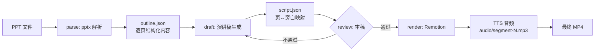

# Repository Guidelines

> 本仓库当前为空：本文档是 ppt-to-presentation 技能的**蓝图与约定**，随脚手架落地逐步更新为事实描述。

## Project Overview

把一份 PPT 自动转换成介绍视频（narrated presentation video）的 superpowers 风格技能。流水线四步：

1. **解读 PPT** — 提取每页标题、正文、图表、演讲者备注，产出结构化大纲（JSON）。
2. **撰写演讲稿** — 按页生成旁白文案，与页面一一匹配（slide N ↔ narration segment N）。
3. **审稿** — 检查通顺性、合理性、逻辑性（页间衔接、术语一致、时长与页面信息量匹配），不通过则回步骤 2 修订。
4. **合成视频** — 依据演讲稿 + PPT 用 Remotion 渲染逐页画面，配 TTS 音频，输出最终视频。

## Architecture & Data Flow



- **单向数据流，中间产物落盘**：`outline.json` → `script.json` → `audio/` → `video.mp4`。每一步可独立重跑；`script.json` 是人可审、可手改的枢纽产物。
- **技能编排层**（SKILL.md）只负责流程控制与阶段门（审稿门），不含业务逻辑；四步各对应 `steps/` 下的实现模块。
- **审稿是循环而非直线**：review 不通过时携带具体问题清单回到 draft，而非整体重来。

## Key Directories

```
.claude/skills/ppt-to-presentation/
├── SKILL.md            # 技能入口：流程编排、阶段门、触发条件
├── references/         # 分步操作细节（解析、写稿、审稿、合成）
└── scripts/            # 可执行辅助脚本（Bun + TS）

src/                    # 核心实现（若抽为独立包）
├── parse/              # pptx → outline.json
├── draft/              # outline.json → script.json
├── review/             # script.json 审稿与修订循环
└── render/             # Remotion 工程与 TTS 拼装

remotion/               # Remotion 项目：每页一个 <Slide/> 组件
```

## Development Commands

```bash
bun install                  # 安装依赖
bun run parse <deck.pptx>    # 步骤1：生成 outline.json
bun run draft outline.json   # 步骤2：生成 script.json
bun run review script.json   # 步骤3：审稿（输出问题清单）
bun run render script.json   # 步骤4：Remotion 渲染 + TTS 合成
bun test                     # 全量测试
bunx remotion studio         # 可视化预览逐页渲染效果
```

## Code Conventions & Common Patterns

- **运行时**：Bun + TypeScript，strict mode；优先 `Bun.file()` / `Bun.$`，不用 Node 专属 API。
- **数据契约**：步骤间只通过 JSON 文件（`outline.json`、`script.json`）耦合，各步骤定义并导出 Zod schema 校验输入输出——schema 即接口文档。
- **命名**：文件 kebab-case，类型 PascalCase；页索引从 1 开始与 PPT 页码对齐，避免 0/1 混用 bug。
- **页↔稿映射不变式**：`script.json` 中每个 narration segment 必须携带 `slide` 字段；review 与 render 均以该字段驱动，禁止按数组顺序隐式对齐。
- **错误处理**：解析失败/页缺失等可预期错误抛出带上下文的 `Error`（含页码），不在库层打日志；SKILL.md 编排层负责决定重试或中止。
- **长任务**：render 阶段页数多时分页并行渲染，TTS 分段调用；每段音频时长写入 `script.json` 供对齐校验。

## Important Files

| 文件 | 作用 |
|---|---|
| `SKILL.md` | 技能入口，定义四步流程与审稿门条件 |
| `src/parse/index.ts` | 步骤1入口：pptx → outline.json |
| `src/draft/index.ts` | 步骤2入口：写稿与页匹配 |
| `src/review/index.ts` | 步骤3入口：审稿规则与问题清单输出 |
| `src/render/index.ts` | 步骤4入口：调度 Remotion 渲染与音频拼装 |
| `remotion/Root.tsx` | Remotion 组件注册（每页一个 Composition） |
| `scripts/*.ts` | 端到端串联与调试用脚本 |

## Runtime/Tooling Preferences

- **Bun 是唯一运行时**：`bun run` / `bun test` / `bunx`；不使用 npm scripts 包装，不引入 tsx/ts-node。
- **包管理**：Bun 内置（`bun.lockb`），不混用 npm/yarn lockfile。
- **技能形态**：遵循 superpowers 约定——SKILL.md 为入口，流程类技能在实现前先走 brainstorming/TDD；references/ 存放分步细节避免 SKILL.md 膨胀。

## Testing & QA

- **框架**：`bun test`（内置，不引入 vitest/jest）。
- **测试策略**：
  - parse：用 `fixtures/sample.pptx` 断言 outline.json 的页数、标题、备注提取正确。
  - draft/review：schema 校验 + 映射不变式（每 segment 有 slide 字段、页码连续）。
  - render：断言分镜计算（segment 时长 ↔ slide 持续帧数）逻辑，渲染产物本身用 `bunx remotion studio` 人工核验。
- **审稿门**：`bun run review` 退出码非 0 即视为不通过，是步骤 4 的前置条件；CI 中视作测试的一部分。
