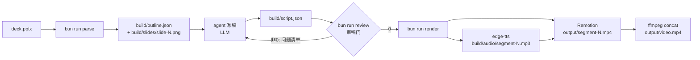

# Repository Guidelines

> 状态：四步流水线已实现并通过单测；端到端冒烟见文末"验证状态"。

## Project Overview

ppt-to-presentation：把一份 PPT（.pptx）自动转换成带旁白的介绍视频的 superpowers 风格技能。四步流水线：

1. **parse** — 解读 PPT：提取逐页标题/正文/备注 + 高保真页面图，产出 `build/outline.json`
2. **draft** — agent 在对话中按页写旁白，产出 `build/script.json`（页↔稿映射）；CLI 做 schema + 对齐校验
3. **review** — 审稿门：agent 自审（通顺/合理/逻辑/一致/匹配）+ `bun run review` 硬门（退出码非 0 禁止渲染）
4. **render** — edge-tts 逐段合成旁白并回填时长，Remotion 渲染逐页画面，ffmpeg 拼接 → `output/video.mp4`

## Architecture & Data Flow



- **步骤间只经 JSON 文件耦合**（`build/`），每步可独立重跑；`script.json` 是人可审可手改的枢纽。
- **agent/脚本分工**：写稿与审稿是 LLM 工作（编排见 SKILL.md）；解析、校验、TTS、渲染是 Bun 脚本。
- **审稿是循环**：review 输出编号问题清单，agent 携清单修订 draft，不整体重来。

## Key Directories

```
.claude/skills/ppt-to-presentation/SKILL.md   # 技能入口：编排、写作要求、审稿门
src/
├── schema.ts        # Zod schema：Outline/Script + validateOutline/validateScript
├── parse/
│   ├── pptx.ts      # JSZip 解 pptx XML：sldIdLst 顺序、<a:t> 文本、rels 关联备注
│   ├── slides.ts    # soffice → pdf → pdftoppm 出页图，归一化 slide-N.png
│   └── index.ts     # CLI：bun run parse <deck.pptx>
├── draft/
│   ├── align.ts     # checkAlignment：slide 字段对齐不变式（draft/review 共用）
│   └── index.ts     # CLI：bun run draft [script.json]
├── review/index.ts  # CLI 审稿门：bun run review [script.json]
└── render/
    ├── tts.ts       # edge-tts 合成 + ffprobe 时长回填 durationSec
    ├── remotion/    # Root.tsx（每页一个 Composition）+ SlideComposition.tsx
    └── index.ts     # CLI：bun run render → output/video.mp4
tests/               # bun test：schema/parse/align/tts 4 套 15 用例
fixtures/            # sample.pptx（make-fixture.ts 生成）
```

## Development Commands

```bash
bun install                  # 安装依赖
bun run parse <deck.pptx>    # 步骤1：build/outline.json + 页图
bun run draft build/script.json   # 步骤2：schema+对齐校验（退出码非0=按清单修订）
bun run review build/script.json  # 步骤3：审稿门（退出码0才可渲染）
bun run render build/script.json  # 步骤4：TTS+Remotion+ffmpeg → output/video.mp4
bun test                     # 全量测试（15 用例）
bunx remotion studio src/render/remotion/Root.tsx   # 可视化预览
```

## Code Conventions & Common Patterns

- **Bun 唯一运行时**，TS strict + `noUncheckedIndexedAccess`；shell 用 `Bun.$`，文件用 `Bun.file`。
- **数据契约**：`src/schema.ts` 单一事实源；slide 页码 1 起始、与 PPT 页码对齐；`durationSec` 只由 render 回填，禁止手填。
- **映射不变式**：`segments[].slide` 必须覆盖 1..slideCount、无重复无缺页——`checkAlignment` 强制，禁止按数组顺序隐式对齐。
- **错误处理**：可预期错误抛带上下文 `Error`（含页码/路径），库层不打日志；CLI 层 catch 后 `console.error` + `process.exit(1)`。
- **CLI 模式**：每个步骤一个 `index.ts`，`process.argv` 取参，退出码即门信号。
- **Remotion props**：`Composition` 用 zod schema（`slidePropsSchema`）+ 推导泛型；页面图/音频经 `staticFile` 解析。

## Important Files

| 文件 | 作用 |
|---|---|
| `.claude/skills/ppt-to-presentation/SKILL.md` | 技能入口：四步编排、写作要求、审稿清单 |
| `src/schema.ts` | outline/script Zod schema（接口契约） |
| `src/parse/pptx.ts` | pptx XML 解析核心（sldIdLst 顺序 + rels 备注关联） |
| `src/draft/align.ts` | 对齐不变式（draft 与 review 共用） |
| `src/review/index.ts` | 审稿门（编号问题清单） |
| `src/render/tts.ts` | edge-tts + ffprobe 时长回填 |
| `src/render/remotion/SlideComposition.tsx` | 页面呈现组件（改动效在此） |
| `docs/superpowers/specs/2026-11-11-ppt-to-presentation-design.md` | 设计 spec |
| `docs/superpowers/plans/2026-11-11-ppt-to-presentation.md` | 实施计划 |

## Runtime/Tooling Preferences

- Bun 1.4+（`bun run` / `bun test` / `bunx`），不混用 npm/yarn lockfile。
- 外部 CLI 依赖（SKILL.md 步骤 0 前置检查）：`soffice`（LibreOffice）、`pdftoppm`（poppler）、`edge-tts`（pip）、`ffmpeg`。
- 技能形态遵循 superpowers：spec → plan → TDD 执行；references/ 待分步细节扩充。

## Testing & QA

- `bun test`，15 用例 4 套：schema（4）、parse/extractSlides（4）、align 不变式（4）、tts plan（3）。
- 测试只用纯函数与 fixture pptx；外部 CLI 路径（soffice/pdftoppm/edge-tts/ffmpeg）由端到端冒烟覆盖，不做单测 mock。
- 审稿门退出码语义：`review` 非 0 = 不通过，是 render 的前置条件。

## 验证状态

- 单测：15/15 通过（bun test）。
- 端到端冒烟：pending 外部 CLI 安装完成后执行（parse→draft→review→render 全链路）。
